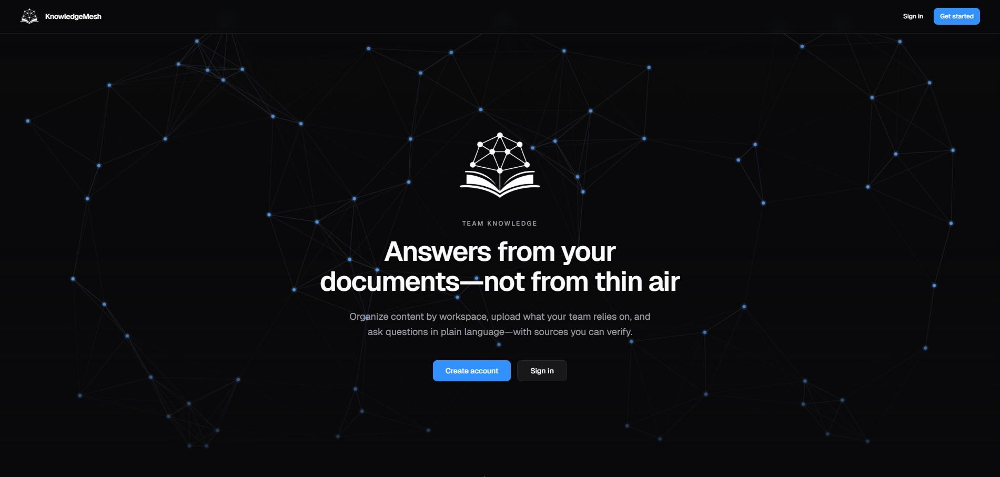

# KnowledgeMesh

# KnowledgeMesh

**Your documents. One place to ask. Answers you can prove.**

Upload your team's documents, ask questions in plain English, and get answers tied to real source passages — not unchecked model text. Every response includes citations so you can verify exactly where the answer came from.

---

## What makes it different

Most RAG tools return an answer and hope you trust it. KnowledgeMesh returns `cited_indices` alongside every response — passage-level references merged by the gateway so the UI can show you the exact source. Answers are provable, not just plausible.

Workspaces are fully isolated. Documents uploaded to one workspace are never retrievable from another — enforced at the query and embedding level, not just the UI.

---

## Architecture

Five services orchestrated by Docker Compose with health-gated startup:

| Service | Role |
|---|---|
| **Gateway** | Single entry point — handles auth, rate limiting, request routing |
| **Ingestion worker** | Pulls from Redis queue, extracts text, chunks, embeds, writes to pgvector |
| **Retrieval service** | Semantic search with MMR reranking, returns top-k chunks with metadata |
| **LLM service** | Generates answers with cited_indices, supports OpenAI and Ollama |
| **Frontend** | Next.js dashboard — documents, streaming queries, diagnostics |

NGINX proxies the frontend and strips `/api` prefixes so internal services stay at `/v1/...`.

---

## Stack

| Layer | Tech |
|---|---|
| **Web** | Next.js, React, TypeScript, Tailwind CSS |
| **API** | Python, FastAPI, Pydantic |
| **Data** | PostgreSQL 16, pgvector, Redis |
| **AI** | OpenAI (embeddings + chat), Ollama (local chat via `LLM_PROVIDER`) |
| **Infra** | Docker Compose, NGINX |

---

## Key Technical Decisions

**MMR reranking** — Maximal Marginal Relevance re-orders retrieved chunks to reduce redundancy before passing to the LLM. Better context window utilization, more complete answers.

**Hybrid LLM routing** — Switch between OpenAI and a local Ollama model by setting `LLM_PROVIDER`. No code changes needed. Useful for cost control or offline environments.

**SSE streaming** — Query responses stream token-by-token to the UI. No waiting for the full completion.

**Health-gated startup** — Docker Compose waits for each service to pass health checks before starting dependents. Cold 502s are rare.

**Rate limiting** — Gateway enforces per-IP rate limits on `/query` and `/query/stream` endpoints.

---

## What's built

- JWT auth and workspace membership
- Document upload, background ingestion status, preview
- Async Redis ingestion queue with worker pipeline (extract → chunk → embed)
- Semantic search with citation-backed answers
- SSE streaming query path
- Dashboard with indexed document counts and query activity
- Diagnostics API and UI
- Access logging

---

## Docs

| File | Contents |
|---|---|
| `docs/how-to-run.md` | Docker Compose setup, ports, Ollama profile |
| `docs/architecture.md` | Request paths, data stores, security model |
| `docs/repository-structure.md` | Directory map, RAG pipeline diagram |
| `docs/api-overview.md` | Full HTTP surface |
| `docs/decisions.md` | Architecture decision records |
